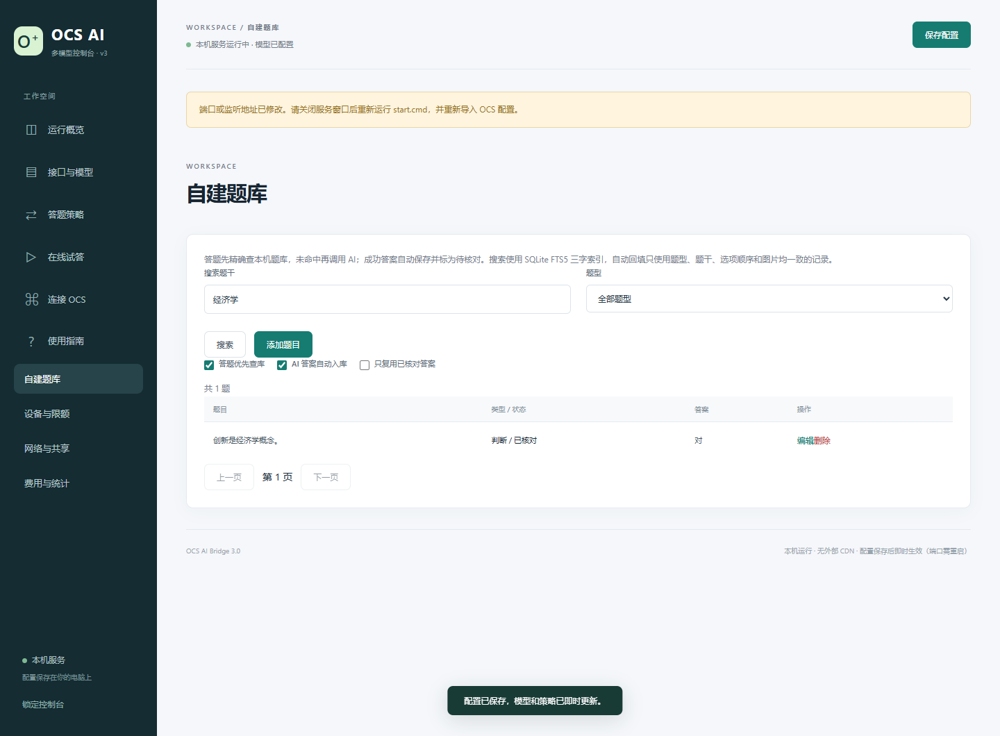
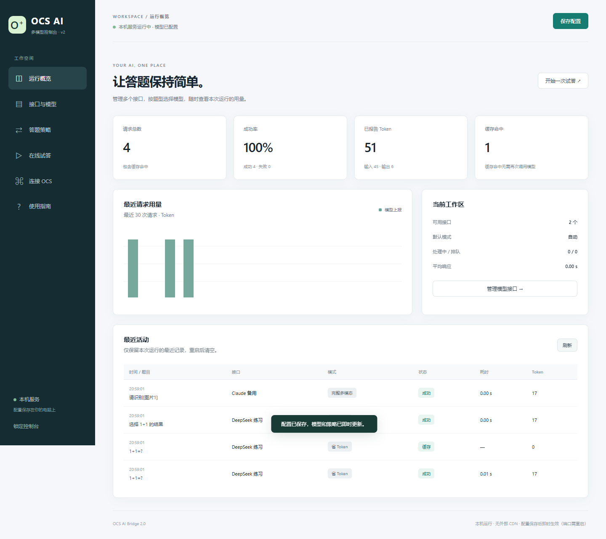

# OCS AI Bridge 3.0 · 多模型可视化控制台

在浏览器里管理模型和 Key、选择答题策略、测试文字或图片题，并导出 OCS 配置。支持 OpenAI Chat Completions 与 Anthropic Claude Messages 两种上游协议；同一服务商可以配置多个模型，不同服务商也可以组合使用。

**第一次使用：**阅读 [快速上手](docs/QUICKSTART.md)，按“下载 → 启动 → 填接口 → 试答 → 导入 OCS”完成配置。遇到问题查看 [故障排查](docs/TROUBLESHOOTING.md)。密钥保存与提交规则见 [密钥与隐私](SECURITY.md)。

## V3 新功能

- 修复判断题 A/B 格式问题：按明确的“正确/错误”原始选项转换，无法映射时仅修正一次，不猜对应关系。
- **自建题库**：SQLite 持久化，默认先查题，AI 成功后自动入库；支持中文搜索、题型筛选、图文编辑、停用和人工核对。
- **本地模型**：Ollama / LM Studio 预设，可连接本机或局域网中的兼容模型服务。
- **设备共享**：局域网监听、自有公网根地址、独立设备令牌、配置导出、IP规则、每天次数/Token/费用及并发限额。
- **费用统计**：持久化设备与IP用量，按北京时间日期汇总，按DeepSeek官方人民币价格和高峰窗口估价，可编辑假期与模型价格。

配置步骤和计费边界见 [V3 完整指南](docs/V3.md)。公网可达性仍需要自己的域名/服务器/路由器配置；程序提供连接与导出，不会自动部署公网服务。



## 下载和安装

需要 [Node.js 22.13 或更新版本](https://nodejs.org/)，Windows 使用安装程序安装完成后重新打开终端。项目使用 Node.js 内置模块，**不需要 npm install**。

- 网页下载：仓库页面点击 **Code → Download ZIP**，完整解压后再运行 `start.cmd`。私有仓库需要先登录有访问权限的 GitHub 账号。
- Git 下载：

```powershell
git clone https://github.com/wuwu181/ocs-ai-bridge.git
cd ocs-ai-bridge
.\start.cmd
```

macOS / Linux 在解压或克隆的目录运行 `node launcher.mjs --no-browser`，再打开终端显示的本机地址。Windows 一键启动和端口处理流程已验证，其他系统以 Node.js 接口测试为主。



截图中的请求数、接口名称及 Token 图表为模拟数据，用于展示布局。

## 三步开始

1. 解压整个目录，双击 **start.cmd**。需要 Node.js 22.13 或更新版本，无需 `npm install`。首次启动自动创建配置并打开控制台。
2. 打开“**接口与模型**”，编辑 DeepSeek 预设，或新增其他接口。填写完整接口地址、模型 ID、API Key，点击“应用到工作区”，再点顶部“**保存配置**”。
3. 在“**连接 OCS**”选择模式，复制或下载题库配置，导入 OCS“通用 → 全局设置 → 题库配置”。通常只导入选中的一份，避免重复调用。

本机默认地址：`http://127.0.0.1:8765/`。启动器会自动登录打开控制台；手动访问时，使用本机 `.env` 文件中的 `OCS_BRIDGE_TOKEN` 登录。

**保持服务窗口运行。**关闭或按 `Ctrl+C` 后，本机接口会停止。

## 三种答题模式

| 模式 | 范围 | 默认用量控制 |
| --- | --- | --- |
| 自动（推荐） | 普通文字题用省 Token，带图片或题干包含证明、推导、论述、编程、设计题时用完整模式 | 自动选择对应上限 |
| 省 Token | 文字单选、多选、判断、填空、简短解答 | 选择 / 判断最多 32 Token，填空 / 解答最多 512 Token，每个候选接口默认只尝试一次 |
| 完整多模态 | 文字与多图、题干图、图片选项、公式截图，以及完整主观解答 | 默认输出上限 4096 Token，最多一次重试或格式修复 |

输出上限不是每题固定消耗量。省 Token 模式按题型发送短提示词，不要求输出冗长 JSON 对象；具体用量仍取决于题目、模型和答案长度。

自动 / 完整模式导入 OCS 后，**开启“图片题优化”**，让 OCS 在浏览器中读取图片并转为 Base64。仅导入省 Token 配置时关闭该功能。省 Token 专用接口不接收图片，遇到图片会明确返回原因。

DeepSeek 省 Token 预设关闭深度思考。其他模型是否能够关闭推理取决于服务商和模型自身，可在接口的“省 Token 专用参数”中设置。原生推理模型可能需要更高的输出上限，否则隐藏思考也可能耗尽上限。

## 控制台功能

- **运行概览**：本次运行的请求数、成功率、Token 用量、缓存命中、最近活动和用量图。记录保留在内存，重启后清空。
- **接口与模型**：新增、编辑、启用或移除多个接口；同一平台可配置不同模型。Key 输入框留空保留原值；明确勾选“清除已保存 Key”才会清除。
- **模型列表查询**：保存接口后可查询服务商的模型列表。部分兼容端没有列表接口，可以直接填准确模型 ID 后试答。
- **答题策略**：分别设置文字、图片、文字多选、文字主观题的候选顺序；默认模式、输出上限、并发数和端口均可在页面调整。
- **在线试答**：输入题目和选项，选择接口、模式和题型，也可以上传图片。试答会真实调用模型并产生对应服务商用量；取消会通知接口中止等待。
- **连接 OCS**：导出自动、省 Token、完整多模态三类配置，可选固定到某个接口。导出只含本机访问 token，不含模型 API Key。
- **使用指南**：页面内提供首次配置、模式说明、日常启动和问题排查。

保存配置后，模型、Key、路由和答题策略**即时生效**。修改端口或监听地址需要重新运行 `start.cmd`，并重新导入新的 OCS 配置。每次保存前会在 `backups/` 保留上一份本机配置。

## 接口地址和协议

| 服务商 / 协议 | 完整 endpoint 示例 | 鉴权 |
| --- | --- | --- |
| DeepSeek / Chat Completions | `https://api.deepseek.com/chat/completions` | Bearer Key |
| OpenAI / Chat Completions | `https://api.openai.com/v1/chat/completions` | Bearer Key |
| Anthropic Claude / Messages | `https://api.anthropic.com/v1/messages` | x-api-key 或 Bearer；另带 anthropic-version |
| 第三方 Chat Completions 兼容端 | 该平台提供的完整 `/chat/completions` 地址 | 按该平台要求 |
| 第三方 Claude Messages 兼容端 | 该平台提供的完整 `/messages` 地址 | 按该平台要求 |

URL 必须是完整请求地址，不是只填域名或 `/v1`。模型 ID 按你的账号和服务商实际提供的名称填写。图片能力也取决于具体模型，勾选“支持图片”不会赋予纯文本模型视觉能力。

对于自建无鉴权模型，可以选择“无鉴权”。使用原生 AWS IAM 等特殊签名的服务，需要额外协议适配，不属于本版两种通用适配器的范围。

### 高级参数

模型编辑窗口可设置完整输出上限、上限参数名、Claude 版本头，以及额外请求体 / 请求头。省 Token 模式还可以单独覆盖输出上限和专用请求参数。

例如 DeepSeek 省 Token 专用参数：

```json
{"thinking":{"type":"disabled"}}
```

OpenAI 模板使用 `max_completion_tokens`，DeepSeek 模板使用 `max_tokens`。其他兼容服务按其文档选择。`jsonMode` 只对完整模式生效，且须由模型支持 `response_format:json_object`；省 Token 模式不发送这个参数。

Claude 官方模板版本头按本次核对文档使用 `2026-10-21`。第三方 Messages 兼容端按其要求设置版本；需要工作区的 Key，可在额外请求头中配置 `anthropic-workspace-id`。

## 路由与回退

候选接口按页面从上到下的顺序尝试。使用上移箭头调整优先级：

- 带图片的题使用“图片题”路由，只使用已启用并声明支持图片的接口。
- 文字多选或主观题配置了专用路由时优先使用；未配置则使用“文字题”。
- 每个请求也可指定 `profile` 固定一个已定义接口。
- 默认省 Token 每个候选只尝试一次；完整模式允许一次格式修复或临时故障重试。
- 上游 401、402、403 不会在同一接口上重复请求；配置了备选才换下一个接口。

只配置实际打算使用的候选。多个候选可能产生多次模型调用，相关用量会汇总到该次请求。明确返回不确定、图片缺失或答案被截断时不会强行回填。

OCS 请求超时约 60 秒，本机默认总预算 50 秒，包含排队和所有候选。慢模型或长时间推理可能超时。中止等待并不保证服务商不对已经生成的内容计费。

## Token 统计与缓存

控制台只汇总服务商响应中实际报告的 `usage`，不使用字符估算假装实际用量：

- 没有报告 `usage` 的请求显示“未上报”。
- 缓存命中不再发起模型调用，该次新增模型 Token 计为 0。
- 一次请求内已收到用量的重试 / 备选调用会累计。
- 统计仅覆盖当前服务进程接收到且包含用量信息的响应，不能代替服务商账单。

缓存区分模型配置、模式、题目和图片；保存模型配置后新请求不会误用旧设置的缓存。“答题策略”中可以手动清空缓存。

## 启动、诊断和升级

| 文件 / 命令 | 用途 |
| --- | --- |
| `start.cmd` | Windows 日常启动，自动打开控制台 |
| `configure.cmd` | 打开相同控制台入口 |
| `diagnose.cmd` | 检查 Node.js 和本地配置；不调用付费模型 |
| `node launcher.mjs --no-browser` | 只启动服务，不自动打开浏览器 |
| `node launcher.mjs --port 8877` | 指定起始端口 |
| `node launcher.mjs --check` | 终端诊断 |
| `node setup.mjs` | 保留的终端配置向导；会把默认路由切换到所选服务商 |

重复启动同目录、同 token 的 v2 实例会直接打开已有控制台。端口被其他程序或旧版服务占用时，启动器会尝试后续空闲端口，更新本地端口和 OCS 导入文件；不会终止其他进程。

**从 v1 升级：**关闭旧服务窗口，保留原目录的 `.env` 与 `config.json`，用新版程序文件覆盖其余文件，再双击 `start.cmd`。旧配置缺少的新设置会使用默认值；首次在管理页保存时写入这些设置。到“连接 OCS”重新导出一份配置导入。

首次启动会自动生成 `ocs-auto.json`、`ocs-lite.json`、`ocs-full.json`。`ocs-local.json` 是自动模式的兼容文件名。日常推荐从网页直接导出，避免复制过期端口。

## 外部调用的三个答题入口

本项目对外使用统一 OCS JSON 请求；Chat Completions 和 Messages 是接口端调用模型时使用的上游协议。

| 请求 | 行为 |
| --- | --- |
| `POST /api/answer` | 使用请求 `mode` 或全局默认模式 |
| `POST /api/answer/lite` | 强制省 Token，仅文字 |
| `POST /api/answer/full` | 强制完整多模态 |
| `GET /health` | 本地服务状态，不调用模型 |
| `GET/HEAD /api/answer...` | OCS 连通性检测，不调用模型 |

答题请求必须使用：

```http
Authorization: Bearer 你的OCS_BRIDGE_TOKEN
Content-Type: application/json
```

```json
{
  "title": "请选择正确结果",
  "type": "single",
  "options": ["1", "2", "3", "4"],
  "mode": "lite",
  "profile": "deepseek"
}
```

`profile` 和 `mode` 可省略。图片请求通过 `images` 传 Base64 data URL 或公开 HTTP(S) 图片 URL，可带 `suggestion_title / suggestion_options` 保留 OCS 图片占位符。`blank_count` 可明确填空数量。

成功返回 `code:1`、`answer`、`display_answer`、`mode`、`profile`、`model`、`usage`、`model_calls` 等。失败返回 `code:0` 和可读的 `error`。本机鉴权失败使用 HTTP 401；已通过本机鉴权的模型错误使用 HTTP 200 + `code:0`，以便 OCS 的 handler 显示真实原因。

健康检查中的 `upstream_checked:false` 表示没有检查模型 Key。模型实际可用性应通过在线试答确认，避免把健康状态误认为付费 API 一定可用。

## 文件与数据

```text
start.cmd / launcher.mjs       启动入口
server.mjs                    本机 HTTP 服务和管理 API
web/                          无外部 CDN 的可视化控制台
lib/                          协议、模式、图片、配置、路由与解析
test/                         集中自动测试（本机模拟上游）
config.example.json           可分发配置模板
.env.example                  密钥变量模板
configs/                      可直接导入的协议模板
README.md / VALIDATION.md     使用说明与验证记录
```

以下文件由你本机生成，不包含在分发包：`.env`、`config.json`、`ocs-local.json`、`ocs-auto.json`、`ocs-lite.json`、`ocs-full.json`、`run/`、`backups/`。其中 `.env` 和备份含密钥，保留在自己的电脑上。

默认只监听本机；模型 API Key 不会出现在控制台读取的配置或 OCS 导出中。管理接口需要本机 token，网页通过会话存储保留登录状态；启动链接中的 token 在页面加载后会从地址栏移除。

如部署到自己的服务器，需要配置监听地址和自己的 HTTPS 入口，并在“连接 OCS”填写真实服务根地址。本包没有替你安装常驻服务或发布到公网。

## 直接导入模板仍可用

不运行本机接口时，`configs/deepseek-direct.json`、`openai-direct.json`、`anthropic-direct.json` 可直接导入 OCS，替换占位 Key 和准确模型 ID 即可。`deepseek-lite-direct.json` 为独立省 Token 版。接口版的可视化配置、题库、设备限额、用量统计和路由不会作用于这些直连配置。`ollama-direct.json` 为本机模型直连模板。

## 验证与已知范围

运行 `npm test` 一次集中验证协议、模式、图片、管理 API 和 OCS 导出。新版已在独立 Edge 无头浏览器里验证模型保存、模型查询、文字 / 图片试答、缓存、配置下载及手机布局，详情见 `VALIDATION.md`。

升级开发阶段使用假 Key 和模拟上游，未修改你现有的 Key，也未调用真实付费模型。实际识图准确率、模型权限和特殊网页控件回填仍需在你的课程环境确认。匹配 / 排序等复杂题可以生成文本解答，自动点击取决于 OCS 本身；音频、视频和 PDF 文件没有接入本版。

## 参考项目与协议文档

界面分区、模型管理、题型路由与用量展示的设计参考了开源项目 [lkd6666/ocs-ai-answerer](https://github.com/lkd6666/ocs-ai-answerer)。本版为本地 Node.js 实现，未复制该项目源代码。

- [OCS AnswererWrapper](https://docs.ocsjs.com/docs/other/api)
- [OCS 5.2.7 全域名源码](https://update.greasyfork.org/scripts/481438/OCS.user.js)
- [DeepSeek 图片输入](https://api-docs.deepseek.com/guides/vision/)
- [OpenAI Chat Completions](https://developers.openai.com/api/reference/resources/chat/subresources/completions/methods/create)
- [OpenAI 图片输入](https://developers.openai.com/api/docs/guides/images-vision)
- [Claude API / 鉴权](https://platform.claude.com/docs/en/api/overview)
- [Claude 图片输入](https://platform.claude.com/docs/en/build-with-claude/vision)
